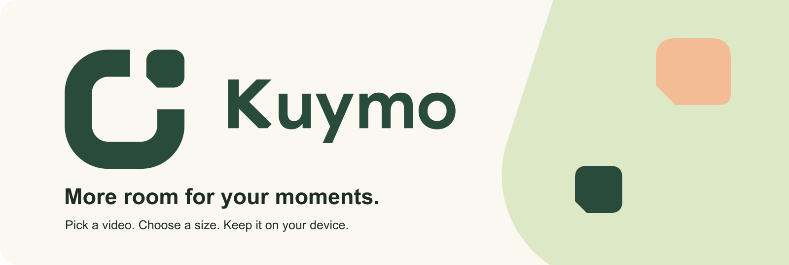
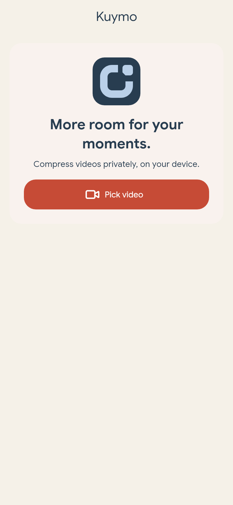

<h1 align="center">Kuymo</h1>

  

  <strong>Smaller videos. More room for the moments you want to keep.</strong> 
  Choose a file size or a sharing preset, preview the tradeoffs, and compress locally on your Android device.

  
  &nbsp;
  
  &nbsp;
  

  <a href="#features">Features</a> ·
  <a href="#interface-preview">Preview</a> ·
  <a href="#using-kuymo">How it works</a> ·
  <a href="https://github.com/MostafaSensei106/Kuymo/releases">Releases</a> ·
  <a href="https://github.com/MostafaSensei106/Kuymo/issues">Feedback</a>

> **Development preview — `0.0.1-dev.1`.** Kuymo is under active development. Video compression currently runs on **Android 11+**. Compression on iOS, web, and desktop is not available yet. **Kuymo AI is coming soon.**

<strong>Contents</strong>

- [Why Kuymo?](#why-kuymo)
- [Features](#features)
- [Interface preview](#interface-preview)
- [Using Kuymo](#using-kuymo)
- [Kuymo AI](#kuymo-ai)
- [Privacy and local data](#privacy-and-local-data)
- [Troubleshooting and FAQ](#troubleshooting-and-faq)
- [Feedback](#feedback)
- [License](#license)

## Why Kuymo?

A video is ready to share, but the file is too large. Lowering a quality slider means guessing, encoding again, and hoping the result fits.

Kuymo starts with the size you need. It uses the video's duration, dimensions, audio, and your chosen limits to plan an output, then checks the file it actually produces. When a request is too restrictive, it explains the compromise or reports that the target cannot be met. Your source video stays available, and video processing takes place on your device.

The goal is a small, approachable set of video tools: useful controls when you need them, a straightforward path when you just want to share a clip, and room for future on-device assistance.

## Features

| Area | What Kuymo offers today |
| :--- | :--- |
| **Choose a target size** | Enter a size in MB and preview planned resolution and bitrate before encoding. |
| **Sharing presets** | Built-in profiles for WhatsApp, WhatsApp HD, Discord, Instagram Reels, TikTok, Facebook, X, YouTube Shorts, and email. |
| **Source-aware planning** | Resolution selection, audio budgeting, rotation and pixel-aspect handling, plus device-specific overshoot calibration. |
| **Advanced controls** | Limit resolution, frame rate, audio bitrate, and video bitrate; remove audio or choose HDR handling. |
| **Local encoding** | Android Media3 uses the device's media codecs. No video upload is part of the compression pipeline. |
| **Verified results** | Check actual file size and output properties; retry an oversized ordinary target within the supported retry budget. |
| **Control an active job** | Progress, pause, resume, cancel, and recovery of supported interrupted jobs. |
| **Keep and share results** | Local compression history, before/after size information, gallery saving, and Android sharing. |
| **Make it comfortable** | Light/dark UI, selectable Material palettes, high-contrast options, localized screens, and right-to-left layouts. |
| **Notifications and haptics** | Separate completion, error, background-status, update, savings-summary, and interaction-feedback preferences. |

Compression is lossy when re-encoding. Output quality, speed, HDR support, and available codecs depend on the source and device. Kuymo does not promise identical visual quality or an achievable size for every input.

## Interface preview

<table>
  <tr>
    <th>Light theme</th>
    <th>Dark theme</th>
    <th>Kuymo AI · coming soon</th>
  </tr>
  <tr>
    <td></td>
    <td></td>
    <td></td>
  </tr>
</table>

Interface previews of the welcome screen and planned assistant experience; full app navigation is not shown.

## Using Kuymo

1. **Pick a video** from your device.
2. **Choose a target size or sharing preset.** Review the planned resolution and bitrate. Use advanced settings if you want to limit resolution, frame rate, or audio.
3. **Start compression.** Follow progress and use pause, resume, or cancel as needed.
4. **Review the result.** Compare actual file sizes and read any quality or target-size warning.
5. **Save or share.** Export to the gallery or share the saved file. Find completed jobs again in local history.

### Target sizes and presets

Sizes use decimal megabytes: **16 MB = 16,000,000 bytes**. A tighter size limit leaves less bitrate for the same video duration, which can mean lower resolution or reduced quality.

Sharing presets are Kuymo's built-in starting points, not a live statement of another service's upload limits. Account tiers and service rules can change. A preset may relax its target when needed; the UI reports that adjustment. Enter a custom size when you have a specific upload cap.

### Output and device support

| Item | Current behavior |
| :--- | :--- |
| Supported compression platform | Android 11 or newer |
| Re-encoded output | H.264 video and AAC audio in an MP4 container; audio can be removed |
| Input support | Formats that the device's installed video and audio decoders can read |
| HDR | Preserve HDR or tone-map to SDR when supported by the selected device pipeline |
| Already-small sources | May pass through without re-encoding when no requested transformation is needed |
| Pause/resume | Pause and resume supported jobs; recovery may restart encoding when saved progress cannot be reused |
| Other platforms | Compression on iOS, web, and desktop is not available yet |

A video that does not need re-encoding can retain its original format. Unsupported input formats are reported clearly.

## Kuymo AI

**Kuymo** is the application. **Kuymo AI** is the planned assistant experience for questions about compression, organization, and saved videos.

The assistant area previews an upcoming experience. AI conversations, working model downloads, and model-based video assistance are not available in the current preview. The model and settings screens do not indicate that an AI model is installed or running.

| Available now | Planned direction |
| :--- | :--- |
| Deterministic, source-aware compression planning | A private video assistant |
| Manual and preset-based video controls | Model-backed recommendations and local video tools |
| A clearly labeled assistant entry | Functional model installation and conversation workflows |

AI features have no promised release date. Follow [issues](https://github.com/MostafaSensei106/Kuymo/issues) for implementation progress and proposals.

## Privacy and local data

- **Video processing happens locally.** Source inspection, planning, encoding, and output verification use the device pipeline.
- **Compression can work offline.** Optional update checks contact GitHub. Checking for updates and future model downloads requires an internet connection.
- **Results and history are local.** Completed outputs and compression-history records are stored on the device. Saving to the gallery creates an export; sharing hands a file to the app you choose.
- **Settings stay on your device.** Theme, language, notification, and compression preferences are managed locally.
- **Permissions have a purpose.** An ongoing notification reports active compression. Manage notification permission in settings; gallery export follows Android's media-access rules.

## Troubleshooting and FAQ

| Problem or question | What to check |
| :--- | :--- |
| **Compression is unavailable on my platform** | Use Android 11+. iOS, web and desktop compression are not currently enabled. |
| **A video format fails to open or encode** | Support depends on the device's installed decoders/encoders. Try a supported source/device; the app reports video/audio decoder and encoder failures separately. |
| **The requested size cannot be reached** | Increase the target, reduce resolution/frame rate, or reduce/remove audio. A long video with a tiny budget may be infeasible. |
| **A preset produces a larger target than expected** | Some presets deliberately relax size to preserve a usable result. Review the resolved target and warning, or choose a custom size. |
| **HDR output looks wrong or is rejected** | Check the selected preserve/SDR mode. Try SDR output if your device cannot preserve HDR. |
| **There is not enough storage** | Allow room for output and pause/resume checkpoints. Manage completed outputs and interrupted work through the app's storage/history flows. |
| **I cannot find a saved video in the gallery** | A saved in-app result and a gallery export are distinct. Use the gallery-saving action and check platform media permissions. |
| **Notifications do not appear** | Check app notification preferences and Android notification permission/settings. The active media service has its own required foreground notification. |
| **Why does AI say “Coming soon”?** | AI assistance and model workflows are still in development; the current screens preview what is planned. |

## Feedback

Help shape Kuymo through [GitHub issues](https://github.com/MostafaSensei106/Kuymo/issues). Bug reports, feature ideas, accessibility feedback, and device-compatibility findings are welcome.

For a video issue, include your Android version, device model, app version, chosen target/preset, and the displayed error. Only share a sample video if you are comfortable making it public; avoid private footage and personal file paths.

## License

Kuymo is licensed under the **GNU General Public License, version 3.0** — **SPDX: `GPL-3.0-only`**. See [LICENSE](LICENSE) for the complete terms.

Bundled fonts and third-party dependencies retain their own licenses. Google Sans and Noto Sans Arabic use the SIL Open Font License; their notices are included under [assets/fonts](assets/fonts) and registered for the app's license screen.

  Built by <a href="https://github.com/MostafaSensei106">MostafaSensei106</a> and contributors · <a href="https://github.com/MostafaSensei106/Kuymo/issues">Help shape Kuymo</a>

