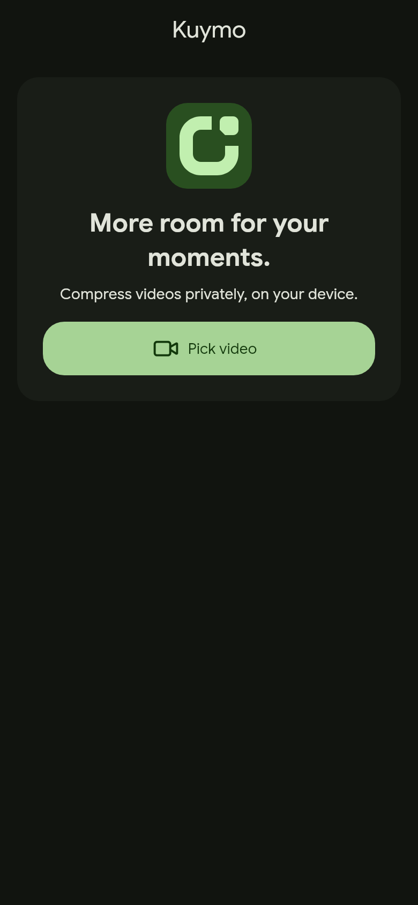
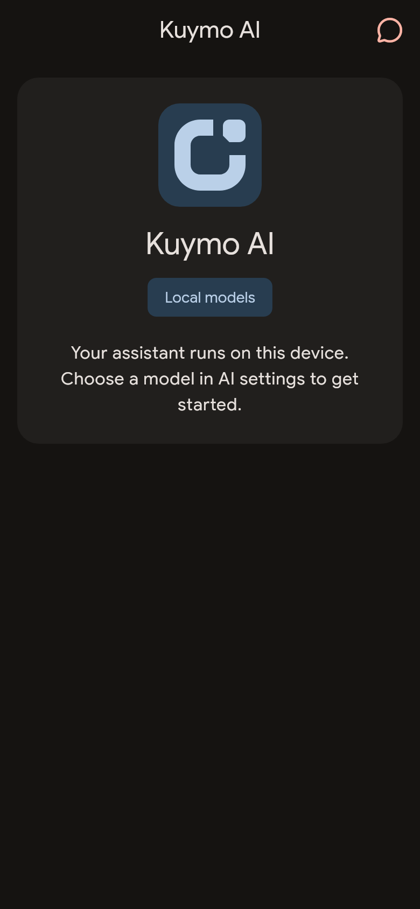

<h1 align="center">Kuymo</h1>

  

  <strong>Big moments. Smaller videos.</strong> 
  Choose the size you need, see the tradeoffs, and get back to sharing. 
  Video compression happens right on your Android device.

  

  
  &nbsp;
  
  &nbsp;
  

  <a href="#download">⬇️ Download</a> ·
  <a href="#features">✨ Features</a> ·
  <a href="#preview">📱 Preview</a> ·
  <a href="#using-kuymo">🎬 How it works</a> ·
  <a href="#faq">💡 FAQ</a>

> **Early preview · `0.0.1-dev.1`** — Video compression currently supports **Android 11+**. The Google Play link is a placeholder. **Kuymo AI is coming soon.**

## 🍃 Make room for the video you want to share

A clip from your trip. A family moment. Something you made. It is ready to send—until the file is too large.

Kuymo starts with a simple question: **how small do you need it to be?** Set a target size or choose a sharing preset, review the planned output, and let Kuymo handle the compression on your device.

<table>
  <tr>
    <td align="center" width="33%">
      <h3>🎯 Start with a size</h3>
      
Choose a target in MB instead of guessing with a quality slider.

    </td>
    <td align="center" width="33%">
      <h3>🔒 Keep it local</h3>
      
Your video is processed on your device, with no upload in the compression flow.

    </td>
    <td align="center" width="33%">
      <h3>🌿 Stay in control</h3>
      
Preview the plan, follow progress, and save or share the result.

    </td>
  </tr>
</table>

## ✨ A little less effort. A lot more control.

| What matters to you | What Kuymo helps you do |
| :--- | :--- |
| 🎯 **Work toward a file-size limit** | Enter a target size and preview planned resolution and bitrate before compression. |
| 💬 **Prepare your next share** | Choose a profile for WhatsApp, WhatsApp HD, Discord, Instagram Reels, TikTok, Facebook, X, YouTube Shorts, or email. |
| 📱 **Process videos locally** | Compress using your Android device's media capabilities. Video encoding can work offline. |
| ⏯️ **Keep control of your time** | Follow progress, pause, resume, cancel, and recover supported interrupted jobs. |
| 🗂️ **Find your results again** | See local compression history, compare before/after file sizes, save to your gallery, and share with another app. |
| 🎛️ **Fine-tune when you want to** | Limit resolution, frame rate, audio bitrate, or video bitrate. Remove audio or choose supported HDR handling. |
| 🌗 **Make it feel like yours** | Choose light/dark UI, Material palettes, high-contrast options, notification preferences, and haptic feedback. Localized screens support right-to-left layouts. |

Kuymo checks the output it produces and reports size or quality adjustments. When a target is too restrictive, it explains the compromise or reports that it cannot be met.

<strong>A note about size and quality</strong>

Re-encoding is lossy. A smaller size budget can mean reduced resolution or quality, especially for longer videos. Results and speed depend on the source and device; identical visual quality and an achievable target are not guaranteed for every input.

## 📱 A calmer place for your videos

<table>
  <tr>
    <th>☀️ Light</th>
    <th>🌙 Dark</th>
    <th>🧠 Kuymo AI · coming soon</th>
  </tr>
  <tr>
    <td></td>
    <td></td>
    <td></td>
  </tr>
</table>

Interface previews of the welcome screen and planned assistant experience. Full app navigation is not shown.

## 📥 Take Kuymo with you

**Android 11 or newer** · Development preview

<!-- GOOGLE_PLAY_URL_PLACEHOLDER: Replace with the verified public listing URL before launch. -->

  

  Google Play link coming soon. The store button currently uses a placeholder, not a verified live listing.

Prefer GitHub? Check [**GitHub Releases →**](https://github.com/MostafaSensei106/Kuymo/releases) for published APKs and release notes. A downloadable APK is available there only when a release includes one.

Compression on iOS, web, and desktop is not available yet.

## 🎬 From too large to ready to share

| Step | Your part |
| :---: | :--- |
| **01 · Pick** | Select a video from your device. |
| **02 · Set** | Choose a target size or sharing preset. Review the planned output; adjust advanced controls if you need them. |
| **03 · Compress** | Start the job and follow progress. Pause, resume, or cancel when needed. |
| **04 · Share** | Review the actual file size and any warnings, then save to your gallery or share the result. |

<strong>🎯 Choosing a target or preset</strong>

Sizes use decimal megabytes: **16 MB = 16,000,000 bytes**. A longer video needs more space to keep the same bitrate, so a very small limit may require a quality or resolution tradeoff.

Sharing profiles are Kuymo's built-in starting points, not live guarantees of another service's upload rules. Limits can vary by account and change over time. A preset may relax its target to keep the result usable; Kuymo reports the adjustment. Use a custom size when you have a specific cap.

<strong>📁 Formats, HDR, and interrupted jobs</strong>

- **Re-encoded output:** H.264 video with AAC audio in an MP4 container. Audio can be removed.
- **Input support:** depends on your device's installed video and audio decoders. Unsupported formats are reported clearly.
- **HDR:** preserve HDR or convert to SDR when the device supports the requested mode.
- **Already-small videos:** may pass through without re-encoding if no requested transformation is needed, retaining their original format.
- **Pause and recovery:** supported jobs can resume; encoding may restart when saved progress cannot be reused.

## 🧠 A little help, coming next

**Kuymo AI** is the planned private assistant for questions about compression, organization, and saved videos.

Today, Kuymo's working tools are target-size compression, sharing presets, and manual controls. AI conversations, functional model downloads, and model-based video assistance are **not available in this preview**. The assistant and model/settings screens preview future work; they do not indicate that a model is installed or running.

There is no promised AI release date. You can share ideas through [GitHub issues](https://github.com/MostafaSensei106/Kuymo/issues).

## 🔒 Your moments stay on your device

- **Local video processing.** Source inspection, planning, compression, and output verification run through the device pipeline.
- **Offline compression.** Encoding does not require an internet connection. Optional update checks contact GitHub; future model downloads would also need a connection.
- **Local results and history.** Completed outputs, compression history, and preferences stay on your device. Gallery export creates a copy; sharing sends a file to the app you choose.
- **Purposeful permissions.** An ongoing notification reports active compression. Notification settings and gallery export follow Android's permission rules.

## 💡 A few things worth knowing

<strong>Can every video fit every target size?</strong>

No. Duration, audio, resolution, and device capabilities limit what is practical. Increase the target, reduce resolution or frame rate, or reduce/remove audio if a request is too restrictive. Kuymo reports adjustments rather than hiding them.

<strong>Why did a sharing preset choose a larger target?</strong>

Some profiles relax the target to preserve a usable result. Review the resolved size and warning, or enter a custom target when you need a specific upload cap.

<strong>Why will a particular format or HDR video not work?</strong>

Codec and HDR support vary by device. Try SDR output if your device cannot preserve HDR. Kuymo distinguishes unsupported video, audio, and encoding failures so you can see what needs attention.

<strong>Where is my compressed video?</strong>

Look in local compression history for saved results. Saving inside Kuymo and exporting to the gallery are distinct actions; use the gallery-saving action when you want a copy there, and check media permissions if needed.

<strong>What if a job stops or storage runs low?</strong>

Allow room for the result and pause/resume checkpoints. Manage saved outputs and interrupted work through the app's storage/history flows. Recovery is supported where the saved job state can be reused.

<strong>Why am I not receiving notifications?</strong>

Check Kuymo's notification preferences and Android notification permission/settings. Active compression has its own required foreground notification.

## 💬 Help shape what comes next

Found a rough edge? Have a video workflow you wish were easier? [**Tell us on GitHub →**](https://github.com/MostafaSensei106/Kuymo/issues)

For a video issue, include your Android version, device model, app version, chosen target/preset, and the displayed error. Only share a sample if you are comfortable making it public; keep private footage and personal file paths out of your report.

## ⚖️ Open source, with room to grow

Kuymo is licensed under the **GNU General Public License, version 3.0** — **SPDX: `GPL-3.0-only`**. Read the complete terms in [LICENSE](LICENSE).

Fonts and third-party dependencies retain their own licenses. Google Sans and Noto Sans Arabic use the SIL Open Font License; their notices are included under [assets/fonts](assets/fonts) and registered for the app's license screen.

---

  <strong>More room for your moments.</strong> 
  <a href="#download">⬇️ Get Kuymo</a> · <a href="https://github.com/MostafaSensei106/Kuymo">Explore the project</a> · <a href="https://github.com/MostafaSensei106/Kuymo/issues">Share an idea</a>

  Made with care by <a href="https://github.com/MostafaSensei106">MostafaSensei106</a> and contributors.

