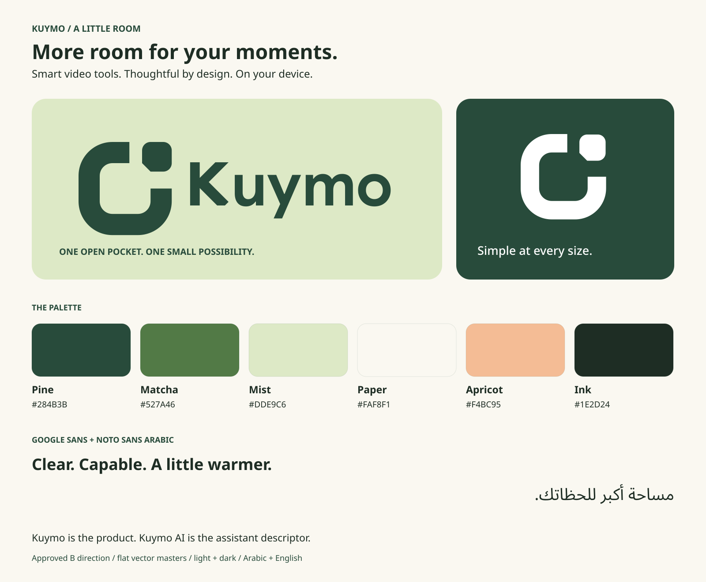

# Kuymo — A little room

Direction **B**, selected by the owner on 25 November 2026. This is the current
identity. The older `brand/rebrand/concepts/` files document the exploration.



## What the identity means

An open pocket leaves room for a small folded tile: less storage pressure,
more room for the videos that matter. The symbol can represent compression,
organization and future intelligent video tools without depending on a play
triangle or a generic AI sparkle. Its fixed orientation is part of the mark;
do not mirror it in Arabic layouts.

**Kuymo** is the product name. **Kuymo AI** identifies the assistant area only.
Do not append AI to the launcher name. Use the Latin spelling consistently;
Arabic UI copy can explain the product naturally around it.

English line: **More room for your moments.**
Arabic line: **مساحة أكبر للحظاتك.** Egyptian: **مساحة أكتر للحظاتك.**

Describe current capabilities plainly: on-device target-size video compression.
AI is a future assistant experience in this build; do not advertise functioning
local inference, model downloads or conversations until implemented.

## Files

- `masters/`: editable SVG paths, no raster logos or required fonts.
- `exports/`: transparent PNGs and browser icon exports.
- `presentation/brand-board.png`: overview of the approved identity.
- `presentation/presentation.html`: six application contexts, self-contained.
- `presentation/screens/`: actual Flutter widget captures, English/Arabic,
  light/dark; captured with bundled fonts and fixture layout.
- `tests/`: small-size and reversed visual inspection sheet and SVG audits.
- `tokens.json`, `tokens.css`: portable brand tokens.
- `process/build_identity.py`: reproducible vector construction; requires
  fontTools and the repository's Google Sans Bold file.

## Mark and lockups

Use `kuymo-horizontal.svg` for a full logo, `kuymo-stacked.svg` when space is
square, and the symbol alone for the launcher and familiar in-app branding.
The wordmark is outlined, with a custom 45° K and adjusted spacing. Do not
retype it. `kuymo-ai-horizontal.svg` is the optional assistant signature.

Use the standard symbol at 24 px and above. Use `kuymo-symbol-small.svg` at
16–23 px; its simplified tile and heavier frame survive rasterization better.
Avoid a symbol smaller than 16 px. Recommended minimum horizontal lockup width:
160 px; stacked: 120 px; wordmark: 100 px. These are screen minima, not print
production specifications.

Reserve clear space of at least one frame thickness around the visible mark
(40 units on the 256-unit symbol grid, about 23% of its visible width). Use the
provided viewBox padding and keep adjacent content outside it. On small UI
controls, use the symbol's built-in 40-unit inset and the control's touch padding.

Black masters are for one-color work. White masters have a slightly lighter
frame and tile for optical balance on dark backgrounds. Keep their geometry;
do not produce reversed artwork by simply recoloring the standard symbol.
No stretching, rotation, gradients, extra outlines, shadows within the symbol,
letter substitutions or attaching unrelated shapes. Background tiles may have
the application's corner radius; store icons are delivered as opaque squares.

## Color and typography

| Token | sRGB | Use |
| --- | --- | --- |
| Pine | #284B3B | Main artwork and dark brand panels |
| Matcha | #527A46 | Material color generation seed |
| Mist | #DDE9C6 | Brand tile and icon background |
| Paper | #FAF8F1 | Presentation background |
| Apricot | #F4BC95 | Supporting illustration accent |
| Ink | #1E2D24 | Brand text and dark splash |

Use Pine on Mist/Paper and white on Pine for brand art. Apricot is a supporting
surface, not a text or status color. UI controls use semantic ColorScheme roles
rather than fixed artwork hex values. The default Auto palette uses Tonal Spot for a softer Matcha treatment.
All 40 existing Material palette/brightness/
contrast combinations were regenerated from Matcha; user choices remain available.
Use semantic error/warning/success signals rather than brand color alone.

UI: Google Sans regular 400, medium 500, semibold 600, bold 700. Arabic fallback:
Noto Sans Arabic regular 400, medium 500, bold 700. Use sentence case, clear
headings and comfortable line spacing. Allow text scaling and RTL wrapping;
do not force Latin tracking onto Arabic. Both fonts ship with their SIL OFL
licenses under `assets/fonts/`; wordmark outlines have no runtime font dependency.

Spacing: 4, 8, 12, 16, 24, 32, 48 px. Corners: 8, 12, 20, 24 px. Preserve at
least 48 px touch targets. A folded tile pattern may support empty states or
marketing surfaces; keep it behind content and avoid turning it into a fake
progress indicator. Motion must respect reduced-motion preferences if added.

These artwork values are sRGB. For print, convert using the printer's actual
ICC profile and approve a proof; no Pantone or universal CMYK match is claimed.

## Application integration

`BrandMark` is the accessible, theme-aware reusable symbol; `BrandLogo` places it
on a theme-aware tile. It is not mirrored in RTL. Shared theme and radius tokens
apply the identity throughout existing screens. Home, onboarding, about and the
assistant entry use the approved mark. Launcher icons include Android adaptive
foreground and monochrome variants; splash artwork has separate light/dark cuts.
Android adaptive artwork keeps the symbol within the central 66 dp safe circle;
web maskable artwork has a separate, more inset composition.

Existing native application IDs, notification channels, persisted preferences,
temporary-job directories and the real GitHub repository name remain compatible.
They are not display branding. Historical artwork is retained as reference.

## Regenerate and verify

From the repository root:

```sh
python3 brand/kuymo/process/build_identity.py
python3 tool/generate_kuymo_schemes.py
python3 -m unittest discover -s tool/tests
flutter gen-l10n
dart run flutter_launcher_icons
dart run flutter_native_splash:create
flutter analyze
flutter test --no-pub
flutter test --no-pub test/brand_identity_test.dart --dart-define=KUYMO_CAPTURE=true
```

The vector builder creates SVG masters and portable tokens. Runtime PNG assets
must also be rendered from those masters before running platform generators;
see `process/render_assets.py`. Web metadata/icons are maintained manually
because this repository currently has no web index entrypoint.

Read [validation](VALIDATION.md) for checks and platform limits. Naming research
is in [NAMING.md](../rebrand/NAMING.md); it is research, not trademark clearance.
